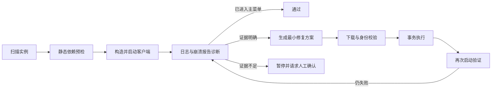

# MAA-Checker

**依据日志和 JAR 元数据判断它为什么进不了主菜单，并在可验证、可回滚的范围内完成修复。**

## 技术栈

| 层次 | 技术 |
| --- | --- |
| 语言与运行时 | Java 21 |
| 桌面界面 | JavaFX 21、JavaFX CSS |
| 构建与测试 | Maven、JUnit 5 |
| 数据解析 | Jackson |
| 网络 | JDK `HttpClient`、`curl.exe` 兜底、Modrinth API、代理探测 |
| 并发 | 虚拟线程、结构化任务服务、可取消任务 |
| Windows 分发 | `jlink` + `jpackage` 完整版，Launch4j 无 JRE 轻量版 |
| 持久化 | JSON 工作流、逐文件事务账本、SHA-256 内容寻址快照 |

核心模块不依赖 JavaFX，命令行入口和桌面界面复用同一套扫描、诊断、规划、执行与恢复逻辑。

## 能做什么

### 启动检查

- 识别本地 `.minecraft/versions` 下的 Forge、NeoForge、Fabric、Quilt 和原版实例；
- 读取实例版本 JSON，选择该实例需要的 Java；
- 按版本 JSON 构造启动参数并启动客户端；
- 同时观察 `logs/latest.log`、客户端标准输出和本次新生成的崩溃报告；
- 判断是否真正进入主菜单，而不是仅凭进程仍然存活就判定成功；
- 保存完整启动命令、日志切片、诊断结果和报告。

### 静态依赖预检

- 只读扫描顶层 JAR 与 JarJar 嵌套 JAR；
- 读取 `neoforge.mods.toml`、`mods.toml`、`fabric.mod.json` 和 `quilt.mod.json`；
- 建立 modId、文件名、声明版本和依赖关系之间的映射；
- 检出缺失前置、加载器版本不足和版本区间冲突；
- 在修复前构建依赖图，用于判断级联影响范围。

### 有边界的自动修复

| 动作 | 用途 | 执行方式 |
| --- | --- | --- |
| 补装前置 | 日志明确指出缺少必需依赖 | 从 Modrinth 获取候选，下载后核对 JAR 内的 modId |
| 更新模组 | 已安装模组低于其它模组要求的版本 | 合并全部版本区间，只接受同时满足约束的版本 |
| 摘除模组 | 模组自身加载失败、Mixin 冲突、重复模组或依赖无法补齐 | 移入恢复目录，而不是直接删除 |
| 升级 NeoForge | 实例加载器版本不足 | 在独立准备目录运行安装器，审核产物后事务切换 |
| 修复 libraries | 共享运行库缺失 | 按版本 JSON 中的 URL 与 SHA-1 补齐，只增不覆盖 |

版本过低支持三种全局策略：

1. **最低兼容版本**：默认，选择满足全部约束的最低可用版本；
2. **最新兼容版本**：选择仍满足全部上下界的最新发布版本；
3. **每次自选版本**：弹窗列出所有兼容版本，由用户查看版本号、文件名和发布日期后选择。

### 工作流与恢复

- 每轮开始前保存版本 JSON、实例顶层模组和必要的整合包标记；
- 每个文件动作都有来源、原因、诊断证据、SHA-256 和执行记录；
- 同一实例的修复与恢复互斥，避免并发写坏实例；
- 达到轮次上限、缺少授权或遇到无法确认的问题时暂停；
- 可从停止轮次继续，也可预览并还原到指定轮前；
- 提供存储占用统计、候选清理和旧轮次回收预览。

### 它不是

- 不是启动器，不负责安装游戏、登录账号或管理 Java；
- 不是通用模组管理器，不会安装与启动故障无关的模组；
- 不判断整合包是否好玩、平衡或适合长期游玩；
- 不保证进入世界后没有运行时问题，检查目标止于主菜单。

## 怎么做的

### 处理流程



### 证据优先

诊断不是按模组名或文件名猜测，而是综合三类信号：

1. **JAR 元数据**：modId、声明版本、依赖和版本区间；
2. **运行日志**：FML 依赖块、模组加载异常、Mixin 错误和客户端输出；
3. **崩溃报告**：本次新增报告中的异常链与模组归属。

静态信息用于构建依赖图和提前发现明显问题；真正触发文件修复的，是本次启动产生的运行期证据。

### 版本更新算法

当一个模组被多个依赖方要求不同版本时：

1. 收集该 modId 的全部版本区间；
2. 检索当前 Minecraft 版本和加载器下可用的 Modrinth 项目；
3. 只保留同时满足全部区间的候选；
4. 按“最低兼容 / 最新兼容 / 用户自选”策略选出目标版本；
5. 下载后读取候选 JAR 内的 modId 和声明版本；
6. 身份或版本不一致时停止；
7. 先安装新文件，再移走旧文件，二者都进入同一事务。

找不到共同兼容版本时会暂停，而不是选择一个不满足约束的最新版继续启动。

### 网络与并发

- API 优先使用可用的镜像通道，失败后回退官方接口；
- 复用代理探测与动态退避逻辑，避免并发请求触发 Modrinth 的 429；
- 下载有连接超时、最低速度判据和总时长限制；
- 扫描、日志诊断、下载和文件操作运行在可取消的虚拟线程任务中；
- 网络失败不会被解释为“模组不存在”，更不会据此删除模组。

## 如何使用

### 选择版本

| 版本 | 文件 | 要求 |
| --- | --- | --- |
| 完整版 | `MAA-Checker-1.0.0-desktop-win-x64.zip` | Windows x64；自带应用运行时，无需安装 Java |
| 轻量版 | `MAA-Checker-1.0.0-light-win-x64.exe` | Windows x64；需要本机 Java 21，且可从 `JAVA_HOME` 或 `PATH` 找到 |

修改整合包需要访问实例目录，请避免把游戏和 MAA-Checker 安装在不允许普通用户写入的系统目录。

### 快速开始

1. 启动完整版中的 `MAA-Checker.exe`，或直接运行轻量版；
2. 在“实例”页选择 `.minecraft` 根目录；
3. 选择要检查的整合包实例；
4. 第一次先运行 **开始检查**，确认实例、Java、内存和诊断结果；
5. 打开“修复策略”，按需设置分类授权、版本更新方式和轮次上限；
6. 运行 **检查并修复**；
7. 任务暂停后查看证据和下一动作，再选择继续、调整策略或还原。

### 分类授权

每个问题类别都可以独立设置：

- **自动执行**：证据满足约束时直接生成并执行修复方案；
- **每次询问**：执行下载或文件修改前请求确认；
- **遇到即停止**：只诊断和记录，不执行该类动作。

版本更新是独立子策略。分类设为“遇到即停止”时不会检索或下载版本；自选模式必须通过桌面弹窗完成，非交互入口会安全暂停。

### 数据保存在哪里

桌面版数据默认位于：

```text
%LOCALAPPDATA%\MAA-Checker\
```

主要目录：

| 路径 | 内容 |
| --- | --- |
| `state\repair-policy-v1.json` | 所有实例共用的修复策略 |
| `state\ui-settings-v1.json` | 外观与动画设置 |
| `state\transactions-v1\` | 逐文件事务与恢复账本 |
| `cache\loader-icons-v1\` | 加载器图标缓存，可安全删除并重新下载 |
| `logs\<实例>\` | 每次启动检查的日志与报告 |
| `<实例>\.maa-checker\` | 轮次工作流、轮前快照和内容对象 |

“存储”页面会区分可直接清理、需要预览确认和受恢复记录保护的数据。“设置”页面可直接打开数据目录。

### 还原

在实例的“轮次记录”中：

1. 选择目标工作流；
2. 选择要还原的轮次；
3. 预览将新增、移除或替换的文件及 modId 版本；
4. 确认后按“模组 → 版本配置 → 整合包标记”的顺序恢复。

恢复操作不会覆盖用户手动修改过且哈希不一致的文件，而是报告冲突并要求处理。

## 开发者指南

### 环境

- JDK 21，且包含 `jpackage` 与 `jlink`；
- Maven 3.9+；
- Windows 10/11 x64 用于构建 Windows 分发产物。

### 常用命令

```bash
# 核心编译与测试
mvn -B -ntp test

# 桌面模块编译与测试
mvn -B -ntp -Pdesktop test

# 本地运行 JavaFX
mvn -Pdesktop compile javafx:run
```

本地构建两种分发产物：

```powershell
powershell -NoProfile -ExecutionPolicy Bypass -File package.ps1 `
  -Version 1.0.0 `
  -Mvn mvn `
  -NoOffline
```

输出位于 `dist/`：

```text
MAA-Checker-1.0.0-desktop-win-x64.zip
MAA-Checker-1.0.0-light-win-x64.exe
SHA256SUMS.txt
```

### 目录结构

```text
src/main/java/         核心扫描、启动、诊断、规划、网络与工作流
src/desktop/java/      JavaFX 界面与桌面服务适配
src/desktop/resources/ 样式、应用图标、第三方声明
src/test/java/         核心单元与集成测试
src/desktop-test/java/ JavaFX 界面测试
packaging/             分发说明、校验脚本与图标源
package.ps1            完整版与轻量版构建入口
```

### 扩展时应保持的边界

- 核心模块不得依赖 JavaFX；
- 网络请求必须复用现有通道管理、代理与退避策略；
- 共享状态使用并发安全容器，长任务必须响应取消；
- 文件修改必须经过方案审核、哈希校验和事务账本；
- 不能让“查询失败”“找不到候选”和“用户拒绝”落入同一个删除分支；
- 修改诊断提示词或结构化文本时，必须保持解析契约稳定；
- 新增 UI 文案应面向用户，不在界面中暴露内部阶段代号或开发过程。

### 测试

测试分为：

- 纯单元测试：版本区间、元数据解析、动作规划、策略与缓存；
- 受控集成测试：进程生命周期、取消、事务恢复和网络失败路径；
- JavaFX 冒烟：布局、主题、紧凑窗口与交互状态；
- 实机验收：真实整合包启动、修复和还原，需要单独环境与明确授权。

提交前至少运行与改动模块对应的编译和测试。涉及文件事务时，应额外验证成功、取消、中断恢复和冲突四条路径。

## 安全边界与已知限制

- 只验证到进入主菜单，不进入世界做长时间稳定性测试；
- 加载器就地升级目前仅支持 NeoForge，其它加载器会转人工；
- 版本区间使用数字序列比较，和加载器语义可能存在边界差异；
- 模组身份以 JAR 内声明的 modId 为准，而非文件名或搜索标题；
- 同名项目无法确认身份时，不安装、也不摘除依赖方；
- 偶发启动竞态允许有限次重试，重试结果会写入风险记录；
- 一次级联摘除有数量上限，超限时暂停并展示影响清单；
- 世界、存档、账号、资源文件和普通配置不在轮前快照内；
- 共享 `libraries` 只增补和校验，不进行全量备份或递归删除。

## 许可证

项目采用 [MIT License](LICENSE)。

分发产物包含 JavaFX、Jackson、Launch4j 等第三方组件。完整许可证说明见打包目录中的 `THIRD-PARTY-NOTICES.txt`。
